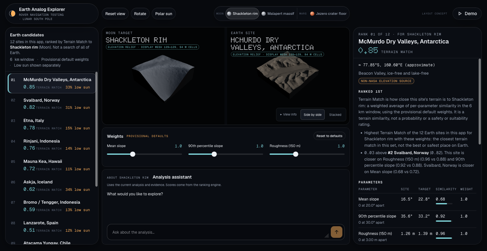
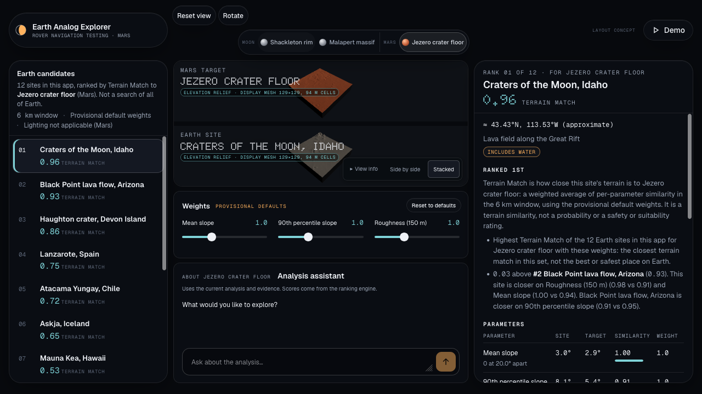

# Workbench layout mockup

This page records a visual concept for the Earth Analog Explorer workbench. It
documents a review artifact; it does not change the production app or mean that
the proposed layout has been accepted for implementation.

## Screenshots

These captures show the interactive concept on the archived preview branch. The
app-source baseline is [`a1c6548`](https://github.com/azrialahmad/earth-analog-explorer/commit/a1c65489d525281f53cb98e0ce19787356703e4d)
(#39/#40), before the SPICE-derived target-lighting update in #43/#44. In
particular, the Moon lighting value/source visible in the first capture is from
that older baseline, not current `main` data.

### Desktop · 1512 × 780 · Moon / Shackleton rim



The ranked list, paired terrain views, persistent weights, assistant, and selected
site details are visible together. The ranking is scoped to the configured sites
in that app revision, not a search of all Earth.

### Compact desktop · 1280 × 720 · Mars / Jezero crater floor



### Mobile · 390 × 844 · narrow workbench


## Concept and limitations

- Ranked Earth candidates stay on the left on wide screens; selected-site details
  stay on the right. The center groups terrain views, weights, and the analysis
  assistant.
- On narrow screens, the app's existing Sites / View / Details navigation is
  used; the capture shows the View pane.
- The concept hides the existing Data and Evidence toolbar entry points without
  completing their migration. That is an acknowledged gap, not a production
  recommendation.
- The assistant is presentation-only in this preview. Submitting text shows a
  preview-only notice; no AI API request is sent and no answer is fabricated.
- Terrain Match remains a comparison against the displayed target and weights,
  not a probability, safety assessment, or suitability rating. Lighting is shown
  separately; Mars remains terrain-only.
- The preview is tied to its source revision and is not maintained against later
  frontend changes. Screenshots should not be read as evidence that the design
  was adopted or that the values match current `main`.

## Interactive review artifact

The executable preview and its tests are preserved on the
[`studio-layout-mockup-archive` branch](https://github.com/azrialahmad/earth-analog-explorer/tree/studio-layout-mockup-archive),
from snapshot commit [`9ccfcf7`](https://github.com/azrialahmad/earth-analog-explorer/commit/9ccfcf70564610b92ee897ec6c8999dcbfed8bc7).
That branch is a frozen review artifact, not a supported or continuously updated
demo. To inspect it with the repository's existing frontend dependencies:

```sh
git switch studio-layout-mockup-archive
cd frontend
node ../docs/mockups/studio-layout/serve.mjs
```

Then open `http://localhost:4177/earth-analog-explorer/`. The mockup branch does
not authorize production UI changes. Any production implementation needs a
separate issue and review by the frontend owner.
