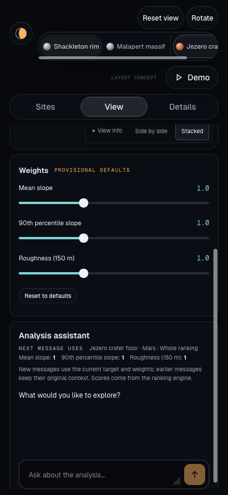

# Workbench layout mockup

This page records a visual concept for the Earth Analog Explorer workbench. It
documents the original review artifact; the screenshots below are not captures
of the later production implementation.

## Production implementation

Following @azrialahmad's permission in
[#117](https://github.com/azrialahmad/earth-analog-explorer/issues/117),
PR #45 now also implements the studio workbench in the ordinary `frontend/src/`
components and styles. It does not ship the preview plugins. Weights and the
assistant are embedded in the center pane; terrain controls move to the header;
Data and Evidence remain accessible. The real assistant transport is retained.
Chat/drafts survive target changes, with canonical per-turn history checked by
the API and cancellation of stale requests/tools.

The archived 1280×720 concept capture below has mesh/title overlap, and the
390×844 concept capture hides the app title and clips target controls. These are
known defects of those pinned screenshots, not intended production behavior.
The production implementation reserves measured label bands above each mesh
and wraps header groups while retaining the app title and reachable controls.

## Screenshots

These Firefox 160 captures use the refreshed, main-based review preview:
app-source/data baseline [`e305c6a`](https://github.com/azrialahmad/earth-analog-explorer/commit/e305c6acb259c3ee437d95d4f7073775c6ca59aa),
with preview code at [`1357069`](https://github.com/azrialahmad/earth-analog-explorer/commit/13570691ea54ca40a2b8211b3cab4099f95c972b).
That baseline contains 30 Earth sites and the target-lighting data shipped at
that revision. These replace the earlier captures of the 12-site, pre-#43/#44
preview; the older artifact is preserved separately below. This is a pinned
snapshot, not a promise that its values track later `main` changes.

### Desktop · 1512 × 780 · Moon / Shackleton rim


The ranked list, paired terrain views, persistent weights, assistant, and selected
site details are visible together. The ranking is scoped to the configured sites
in that app revision, not a search of all Earth.

### Compact desktop · 1280 × 720 · Mars / Jezero crater floor


### Mobile · 390 × 844 · narrow workbench



The View pane is deliberately scrolled down in this capture; the terrain views
remain above it. The full center pane is not expected to fit on one mobile screen.

## Changes demonstrated in the refreshed preview

- The real app components and data now come from the main-source baseline above,
  rather than the older 12-site snapshot. No scientific data or scores were edited
  for this concept.
- **Next message uses** is small, unboxed, and beside **Analysis assistant**.
  The target, body, whole-ranking scope, and full-precision weight values wrap
  without covering the chat or composer.
- Changing target keeps the visible chat, historical turns, and unsent draft.
  Earlier messages retain their own target/weight snapshots; the next Send uses
  the current completed analysis. A context-boundary note is added at that Send,
  not on every target click or slider movement. Reloading is not persistence.
- Context changes still cancel pending requests and invalidate stale replies or
  rerun tools, including after returning A → B → A.

These are preview interactions, not shipped production changes. The assistant
transport remains offline. The production API still rejects mixed-target
history at that snapshot; the proposed follow-up (not yet agreed at that time) is recorded in
[#50](https://github.com/azrialahmad/earth-analog-explorer/issues/50#issuecomment-6895287232).
The later client/API implementation is covered by #117. These archived
screenshots themselves do not demonstrate successful AI answers or request
synchronization.

## Concept and limitations

- Ranked Earth candidates stay on the left on wide screens; selected-site details
  stay on the right. The center groups terrain views, weights, and the analysis
  assistant.
- On narrow screens, the app's existing Sites / View / Details navigation is
  used; the capture shows the View pane scrolled to the assistant.
- The concept hides the existing Data and Evidence toolbar entry points without
  completing their migration. That is an acknowledged gap, not a production
  recommendation.
- The assistant is presentation-only in this preview. Submitting text shows a
  preview-only notice; no AI API request is sent and no answer is fabricated.
- Terrain Match remains a comparison against the displayed target and weights,
  not a probability, safety assessment, or suitability rating. Lighting is shown
  separately; Mars remains terrain-only.
- The preview is tied to its source revision and is not maintained against later
  frontend changes. Screenshots should not be read as evidence that the design
  was adopted or that the values match current `main`.

## Interactive review artifact

The refreshed executable preview and its tests are preserved on the review-only
[`47-main-studio-preview` branch](https://github.com/azrialahmad/earth-analog-explorer/tree/47-main-studio-preview),
pinned above at `1357069`. Its
[README](https://github.com/azrialahmad/earth-analog-explorer/blob/13570691ea54ca40a2b8211b3cab4099f95c972b/docs/mockups/studio-layout/README.md)
records run instructions, limitations, and checks. From a clean checkout with
the repository's frontend dependencies already installed:

```sh
git fetch origin 47-main-studio-preview
git switch --detach 13570691ea54ca40a2b8211b3cab4099f95c972b
node docs/mockups/studio-layout/serve.mjs
```

Then open `http://localhost:4178/earth-analog-explorer/`.

The original 12-site artifact remains unchanged on
[`studio-layout-mockup-archive`](https://github.com/azrialahmad/earth-analog-explorer/tree/studio-layout-mockup-archive),
from source snapshot [`9ccfcf7`](https://github.com/azrialahmad/earth-analog-explorer/commit/9ccfcf70564610b92ee897ec6c8999dcbfed8bc7)
and app baseline `a1c6548` (before #43/#44). Its old Moon-lighting values are not
the data shown in the refreshed captures above.

Both branches are revision-specific review artifacts, not supported demos. The
executable previews remain outside the merge diff. Production changes use the
normal app source under the separate scope and owner permission recorded in
#117; the earlier documentation-only approval is not approval of that new diff.
